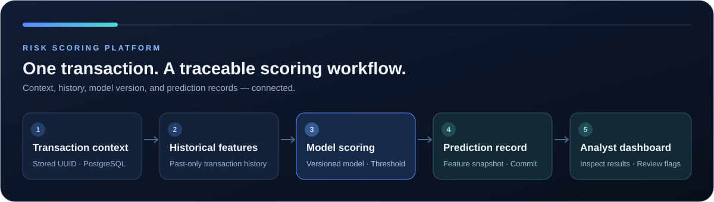

# 🛡️ Risk Scoring Platform

### From a transaction to a traceable risk score.

A full-stack demo connecting fraud-risk scoring, prediction records, and an analyst dashboard.

**[Open Live Demo](https://risk-scoring-platform-sg.onrender.com/ui/)** · **[Explore the API](https://risk-scoring-platform-sg.onrender.com/docs)** · **[Run Locally](docs/SETUP.md)**

## What does it do?

The platform turns a stored transaction into a fraud-risk score using its context and past transaction history. It pairs each prediction with the model version and feature snapshot used, so the result can be inspected later in the dashboard.

It brings together the core parts of an ML application: feature engineering, model serving, authenticated APIs, persistent prediction records, and a React interface for reviewing results.

## Platform at a glance

*A visual overview of the scoring and review workflow. Explore the [architecture guide](docs/ARCHITECTURE.md) for the detailed design.*

## Feature highlights

| Capability | What you can explore |
| --- | --- |
| ⚡ **On-demand scoring** | Score a stored transaction UUID or submit a batch through the API. |
| 🕒 **Time-aware features** | Build 31 features using historical activity available before the scored event. |
| 🧾 **Prediction records** | Inspect saved scores, feature snapshots, model versions, and scoring latency. |
| 📊 **Analyst dashboard** | Follow recent predictions, USD-based KPIs, risk trends, and flagged items. |
| 🧠 **Model visibility** | View registered versions, the serving threshold, and evaluation metrics. |
| 🔐 **Authenticated workflow** | Use JWT-protected scoring and dashboard routes with explicit sign-out. |

Read the [features guide](docs/FEATURES.md) for behavior, safeguards, and workflow boundaries.

## How it works

The API reads transaction context and history from PostgreSQL, constructs the feature vector, and runs the loaded model. It returns a successful score only after the prediction record is committed. The dashboard then retrieves the saved results from the API.

See the [architecture guide](docs/ARCHITECTURE.md) for component responsibilities and the detailed system flow.

## Technology stack

| Layer | Technologies |
| --- | --- |
| **Backend** | Python 3.13, FastAPI, Uvicorn, async SQLAlchemy |
| **Data** | PostgreSQL hosted on Supabase, asyncpg |
| **Machine learning** | scikit-learn Random Forest, pandas, NumPy, Joblib |
| **Frontend** | React 19, Vite, Recharts, Lucide icons |
| **Delivery** | GitHub Actions verification, Render Free hosting |

## Explore the demo

Open the **[Singapore deployment](https://risk-scoring-platform-sg.onrender.com/ui/)** to reach the sign-in screen. Authorized administrators can select a stored transaction, score it, compare the saved result with the feed, and explore the model registry and review queue.

The API and built frontend share one Render web service; PostgreSQL stores transactions and prediction records separately. Free instances sleep after inactivity, so the first visit can take a minute or longer. Admin credentials are private, with no public default login. Follow [local setup](docs/SETUP.md) to run your own instance or [deployment](docs/DEPLOYMENT.md) for hosting and free-tier limits.

## Project status

This is an **educational demo with a working scoring and review workflow**. Scores and recommended actions are advisory; the app does not execute payments or establish confirmed fraud through a review acknowledgement.

Latency and model quality remain areas for improvement. The October 31 checks measured **655–955 ms warm scoring**, above the 50 ms target. The stored model evaluation reports **50% recall and 25% precision** on a small test set. Background monitoring is disabled on the hosted demo. See [performance and limitations](docs/PERFORMANCE.md) for the measurements and their scope.

## Documentation

Brief overviews live here; detailed instructions stay in dedicated Markdown guides.

| Guide | Contents |
| --- | --- |
| [Features](docs/FEATURES.md) | Scoring, authentication, records, dashboard, and review workflow |
| [Architecture](docs/ARCHITECTURE.md) | System flow, components, database, and serving registry |
| [Local setup](docs/SETUP.md) | Prerequisites, environment, disposable test data, and running locally |
| [Deployment](docs/DEPLOYMENT.md) | Render configuration, persistence, free-tier limits, and troubleshooting |
| [API reference](docs/API.md) | Routes, authentication, contracts, timings, and errors |
| [Frontend development](docs/FRONTEND.md) | Vite development, build commands, and dashboard behavior |
| [Verification](docs/VERIFICATION.md) | Tests, CI, PostgreSQL integration, and smoke checks |
| [Models and training](docs/MODELS.md) | Candidate training, promotion, monitoring, and model lifecycle |
| [Performance and limitations](docs/PERFORMANCE.md) | Measured latency, model metrics, and remaining limitations |

## License

No license file is included, and no open-source license grant is asserted.
