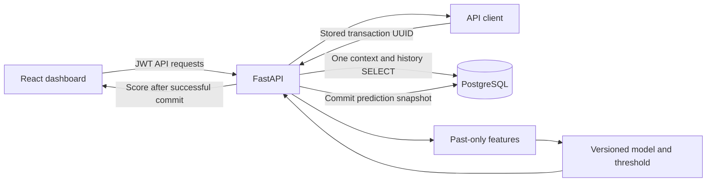

# Risk Scoring Platform

A fraud-risk scoring demo built with FastAPI, PostgreSQL, scikit-learn, and React. It scores transactions already stored in the database, saves successful predictions with their feature snapshots and model versions, and displays results in an authenticated dashboard.

[Live dashboard](https://risk-scoring-platform-sg.onrender.com/ui/) · [API docs](https://risk-scoring-platform-sg.onrender.com/docs) · [Readiness](https://risk-scoring-platform-sg.onrender.com/api/v1/health)

The demo runs on **Render Free in Singapore**, with an external Supabase PostgreSQL database in Tokyo. The first visit after inactivity can take a minute or longer. Admin credentials are private; there is no public default login.

## Capabilities

- JWT-protected single and batch scoring for stored transaction UUIDs.
- A shared 31-feature training/serving contract using completed transactions from the preceding 30 days. Historical aggregates exclude the current transaction, equal timestamps, future events, and labels unavailable at event time.
- A versioned Random Forest, validation-selected threshold, startup compatibility/quality checks, and an in-memory serving bundle.
- Durable prediction logging: success requires the audit commit to succeed. Records include the score, feature snapshot, model version, and latency. Review/outcome fields can subsequently be updated; this is not a tamper-proof audit system.
- Real dashboard data: distinct scored-transaction KPIs, normalized USD amounts, recent predictions, a 30-minute score chart, model registry, and review queue. Data refreshes every 30 seconds.
- Explicit sign-out, session-scoped browser tokens, visible validation errors, sanitized server failures, and request IDs.
- Readiness returns HTTP 503 when the database or serving model is unavailable.
- Optional ground-truth reconciliation and guarded retraining. **Background monitoring is disabled on the Singapore demo**; automated retraining is not an active hosted capability.

Scores and recommended actions are advisory. The app does not execute payments, block transactions, or confirm fraud by acknowledging a review.

## Performance and known limitations

Live browser smoke checks on **2026-10-31** passed login, database/model readiness, scoring, persisted results, score/feed agreement, invalid-input handling, model registry, and the empty review queue. Six predictions were made for one existing transaction; this was not a load test.

| Measurement | Result |
| --- | --- |
| First scoring request after startup | 1,095 ms |
| Five subsequent scoring requests | 655–955 ms; mean 887 ms |
| Target | Under 50 ms — **not achieved** |
| Cold startup | Initial requests timed out while the Free instance woke up |

Displayed scoring latency includes context loading, feature computation, inference, and the durable audit commit. It excludes client-network time and dashboard refreshes. See [API timing headers](docs/API.md).

The current model, `v20261029_production`, uses feature schema version 2 and threshold `0.15826714653647353`. Its stored chronological test evaluation is:

| Metric | Result |
| --- | --- |
| Test transactions / fraud examples | 815 / 20 |
| ROC AUC / PR AUC | 0.808 / 0.339 |
| Precision / recall / F1 | 0.250 / 0.500 / 0.333 |
| True positives / false negatives | 10 / 10 |
| False positives / true negatives | 30 / 765 |

These are limited demo results, not evidence of production readiness. Model quality needs improvement, the evaluation set is small, and the existing evaluation has informed development decisions. Stronger claims require additional representative data and a fresh independent evaluation. See [model metadata](models/metadata_v20261029_production.json) and the [evaluation report](reports/eval_v20261029_production.json).

## Architecture



| Area | Location |
| --- | --- |
| Lifecycle, middleware, static UI | `src/main.py` |
| Auth, scoring, operations, dashboard routes | `src/api/` |
| Context query, inference, audit commit | `src/services/prediction_service.py` |
| Shared feature contract | `src/features/feature_pipeline.py` |
| Training, evaluation, file-backed registry | `src/training/` |
| Optional reconciliation/retraining | `src/services/drift_service.py` |
| ORM tables and connections | `src/database/` |
| Dashboard | `frontend/src/App.jsx` |
| Serving artifacts and registry | `models/` |

The API and built frontend share one Render web service. The serving registry is `models/registry.json`; the database registry table is not the source of the serving model. See [deployment and persistence](DEPLOY_FREE.md).

## Local setup

Use Python **3.13**, Node.js **22.14**, npm, and PostgreSQL. CI uses PostgreSQL 18. Run commands from the repository root; examples use PowerShell.

```powershell
python -m venv venv
.\venv\Scripts\Activate.ps1
python -m pip install -r requirements-dev.txt
Copy-Item .env.example .env
npm --prefix frontend ci
```

Edit `.env` before starting:

- Set `DB_HOST`, `DB_PORT`, `DB_NAME`, `DB_USER`, and `DB_PASSWORD` for your own database.
- Set `ADMIN_USERNAME` and a unique `ADMIN_PASSWORD` of at least 12 characters and at most 72 UTF-8 bytes. Use a generated ASCII password to avoid byte-length ambiguity.
- Replace `SECRET_KEY` with a separate randomly generated secret.
- Keep `DEBUG=false`. Use `ENVIRONMENT=development` for local development.
- Keep `MONITORING_ENABLED=false` for a demo with no background training jobs.

Keep credentials out of Git and screenshots. Without `ADMIN_PASSWORD`, local sign-in returns 503; production startup requires it.

### Prepare local data

Scoring needs the expected tables and stored transactions. The app does not initialize or seed them on startup, and there is no HTTP seed/reset route.

For a **new, disposable local database only**, create an empty database and matching role using PostgreSQL administration tools. Confirm `.env` points to that disposable database, then generate synthetic data:

```powershell
python scripts/seed_db.py --users 20 --merchants 5 --transactions 400
```

**The seeder drops and recreates application tables, deleting existing data.** It refuses `ENVIRONMENT=production`; never change a hosted environment to bypass that guard. New synthetic data does not reproduce the committed model's evaluation dataset.

### Run

```powershell
npm --prefix frontend run build
python -m uvicorn src.main:app --host 127.0.0.1 --port 8000
```

Open [the local dashboard](http://127.0.0.1:8000/ui/) or [local API docs](http://127.0.0.1:8000/docs). Sign in with your configured credentials and select a stored transaction.

For frontend development, keep the API running and run `npm --prefix frontend run dev`. Vite proxies `/api` to `http://127.0.0.1:8000`. See [frontend instructions](frontend/README.md).

## API

The base path is `/api/v1`. Public operations include `/live`, `/health`, `/model-info`, and `/models`. Scoring and every dashboard route require a bearer token obtained through `POST /token`, using form fields `username` and `password`.

Example body for `POST /api/v1/predict`:

```json
{
  "transaction_id": "fbdd18de-ce99-4466-8a0f-ab5127071e88",
  "include_features": false
}
```

The UUID must exist in that database. `fraud_probability` is 0–1; `risk_score` and dashboard scores are 0–100. Batch requests use `transaction_ids` and can return successes alongside per-item errors. See [API contracts and errors](docs/API.md).

## Verification

```powershell
python -m pytest tests -q
npm --prefix frontend run lint
npm --prefix frontend run build
npm --prefix frontend audit --audit-level=moderate
```

The PostgreSQL integration check requires `INTEGRATION_DATABASE_URL` pointing to an isolated test database; otherwise that check is skipped. CI provisions PostgreSQL 18 and runs the full suite plus frontend lint/build and the advisory check. The last full code verification before these documentation changes passed 58 tests.

With the local API running and credentials configured:

```powershell
python scripts/test_api.py --base-url http://127.0.0.1:8000
```

The smoke script never seeds or resets data. It creates prediction records while testing single/batch scoring; use a test database. It prints latency/stage samples, but never credentials.

## Training and model lifecycle

```powershell
python scripts/train_model.py --version v_local_candidate
```

The default training configuration uses chronological train/validation/test partitions, past-only features, and validation-based threshold selection. The command saves a candidate/report without promotion. Review the data, metrics, and quality gates before promoting any candidate.

The optional background path reconciles labels and evaluates recent resolved outcomes for the serving model. Sample/cooldown conditions govern retraining. With `RETRAINING_AUTO_PROMOTE=true`, promotion also requires quality gates and improvement against the incumbent on identical evaluation rows. The serving bundle is refreshed with registry rollback on load failure. This is a single-process mechanism, not a distributed rollout system.

Render Free storage is ephemeral: runtime-trained artifacts disappear on restart/redeploy unless saved externally and deliberately included in a release. Committed curated artifacts provide the demo's restart-safe baseline.

## Deployment and cost

See [DEPLOY_FREE.md](DEPLOY_FREE.md) for configuration, validation, and free-tier limits. `render.yaml` is a template for **one Free web service using an externally supplied database**; it does not provision PostgreSQL.

Free compute does not guarantee a zero total bill: bandwidth and build allowances apply. Cold starts, shared free hours, cross-region database latency, and weak model evaluation remain limitations. No uptime or sub-50 ms guarantee is offered.

## License

No license file is included. This is an educational/demo project; no open-source license grant is asserted here.
