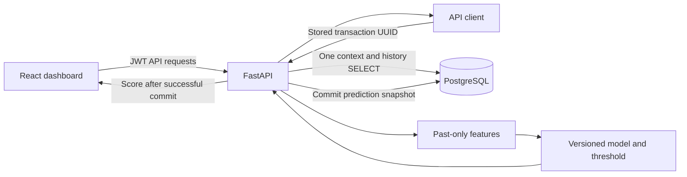

# Architecture

[Project overview](../README.md)

| Area | Location |
| --- | --- |
| Lifecycle, middleware, static UI | `src/main.py` |
| Auth, scoring, operations, dashboard routes | `src/api/` |
| Context query, inference, audit commit | `src/services/prediction_service.py` |
| Shared feature contract | `src/features/feature_pipeline.py` |
| Training, evaluation, file-backed registry | `src/training/` |
| Optional reconciliation/retraining | `src/services/drift_service.py` |
| ORM tables and connections | `src/database/` |
| Dashboard | `frontend/src/App.jsx` |
| Serving artifacts and registry | `models/` |

The API and built frontend share one Render web service. The serving registry is `models/registry.json`; the database registry table is not the source of the serving model. See [deployment and persistence](DEPLOYMENT.md).
